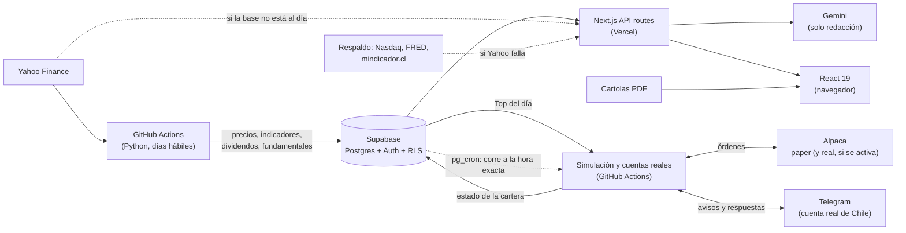

# OmniCapital · asesor de inversiones cuantitativo

Plataforma web que consolida las inversiones de una persona en varias corredoras chilenas e internacionales y las analiza como lo haría un asesor: rentabilidad real con dividendos, riesgo de la cartera completa, análisis técnico y fundamental de cada activo, contexto de mercado y noticias, todo ajustado al perfil del inversionista.

**Demo en vivo:** https://quantum-trader-app.vercel.app (botón *Entrar en modo demo*, con un portafolio ficticio)


## Qué hace

- **Lee las cartolas en PDF** de cinco corredoras (Racional, BTG Pactual, Vector/Zesty, XTB y Fintual), incluso las protegidas con clave, y arma un libro único de compras, ventas, dividendos, impuestos y comisiones. Detecta movimientos duplicados entre archivos, avisa de los meses que faltan y concilia cada período contra el saldo que informa la corredora.
- **Valoriza el portafolio** en pesos y dólares con precios en vivo, y calcula la rentabilidad desde la compra, la TIR y la comparación contra índices.
- **Asesor en cuatro pilares** con reglas explícitas:
  - **Técnico:** tendencia sobre la media de 200 días con banda de ±3%, momentum 12-1, RSI y stop de volatilidad, sobre precios ajustados por dividendos.
  - **Fundamental:** P/U frente a su mercado, ROE, crecimiento, payout, deuda y consenso de analistas. En los ETF, el costo y la composición.
  - **Riesgo:** volatilidad (Newey-West), VaR y Expected Shortfall históricos, covarianza con *shrinkage* de Ledoit-Wolf, beta de Dimson, aporte de cada activo al riesgo y exposición real por empresa, sector y país, contando lo que hay dentro de los fondos.
  - **Mercado:** régimen favorable, cauteloso o defensivo según las tendencias del S&P 500, el IPSA y las acciones globales, más el VIX, el dólar, el cobre y las tasas.
- **Perfil del inversionista:** un cuestionario corto (plazo, tolerancia a caídas, fondo de emergencia, deudas, experiencia) que cambia las recomendaciones. Por ejemplo, no propone aumentar acciones individuales a alguien que necesita el dinero en dos años.
- **Reglas a nivel de cartera:** frena las compras que empeorarían la concentración por sector (más de 35%) o en un país (más de 60%), las de activos casi idénticos a otro que ya se tiene (correlación ≥ 0,9) y las de alto riesgo cuando el mercado está defensivo.
- **IA acotada:** Gemini solo redacta el diagnóstico a partir de los números calculados. Si el texto menciona otra acción o un porcentaje que no está en los datos, se descarta.
- **Noticias** de los últimos 30 días por empresa (Google News y Yahoo Finance), filtradas para que de verdad hablen de la empresa, con su tono resumido.
- **Simulación en vivo (paper trading):** opera con dinero ficticio las 20 acciones del Top de EE.UU., en una cuenta de práctica de Alpaca, y las 5 del Top de Chile, en una cuenta simulada con los precios de la Bolsa de Santiago, y compara cada cartera con el S&P 500 y el IPSA. Cada acción pesa lo que el método medido le asigna (partes iguales en EE.UU., inversa a la volatilidad en Chile); el bot vende la que sale del Top y compra la que entra en cualquier corrida, y una vez al mes vuelve a los pesos exactos. Tiene control de riesgo propio (máximo 8% por acción en EE.UU. y 31% en Chile, freno si el patrimonio cae 3% en un día, stop loss lejano, sin margen ni cortos).
- **Dinero real, apagado hasta activarlo a mano:** el mismo sistema opera una cuenta real de Alpaca con claves aparte y un tope de inversión obligatorio. En Chile, donde las corredoras no tienen API, avisa cada orden por Telegram; el dueño la ejecuta en su corredora y responde con un botón, y el bot lleva el libro de esa cuenta.
- **Otras herramientas:** las cinco oportunidades del día según el *screener*, el calendario de dividendos, un optimizador de compras con nuevo capital y *backtesting*.

| Perfil del inversionista | Mi portafolio |
|---|---|
|  |  |

## Arquitectura



- Un **minero en Python** corre en GitHub Actions cada madrugada de día hábil, con las bolsas cerradas. Sigue unos 600 activos (S&P 500, Nasdaq 100, acciones chilenas, ETFs y los activos de los usuarios) y es incremental: baja solo el último tramo, de a 100 activos por llamada, continúa los indicadores técnicos desde lo guardado y escribe en Supabase solo los días nuevos (cierre real, dividendos y fundamentales). Nunca guarda un día con la bolsa abierta, corrige los días que Yahoo cambió y, si un split cambia el historial, reescribe el activo.
- La **web** lee primero de la base, así que un informe se arma en segundos sin descargar años de precios. Solo si la base no está al día recurre a Yahoo, y si Yahoo falla, a fuentes gratuitas de respaldo.
- Las **cartolas se procesan en el navegador** con pdf.js: los PDF con datos personales no se suben a ningún servidor.

## Tecnologías

| Capa | Herramientas |
|---|---|
| Frontend | Next.js 16 (App Router), React 19, TypeScript, Tailwind CSS 4, Recharts |
| Backend | API routes de Next.js en Vercel (Node), yahoo-finance2, pdf.js |
| Datos | Supabase (PostgreSQL, Auth, Row Level Security) |
| Pipeline | Python (pandas, NumPy, yfinance) en GitHub Actions |
| Simulación | alpaca-py contra Alpaca (paper, y real si se activa) y una cuenta simulada de la Bolsa de Santiago, en GitHub Actions; avisos por la Bot API de Telegram; pg_cron y pg_net de Supabase para correr a la hora exacta |
| IA | Google Gemini (plan gratuito), con salida en JSON validada |
| Cuantitativo | Ledoit-Wolf, Newey-West, VaR y ES históricos, beta de Dimson, paridad de riesgo, frontera eficiente |

## Seguridad y privacidad

- Cada usuario solo ve su portafolio y su perfil (políticas RLS en Postgres). Las tablas de mercado son de solo lectura para la web; únicamente el minero escribe, con una clave que vive en los secretos de GitHub.
- No hay claves en el código: todo va en variables de entorno de Vercel y secretos de GitHub Actions.
- La simulación solo se conecta al servidor de paper de Alpaca y rechaza cualquier cuenta que no sea de práctica. La cuenta real usa otras claves, otro servidor y otro workflow (`real_trading.yml`), que no envía órdenes hasta que la variable `TRADING_REAL` vale `activo` (`TRADING_REAL_CL` para los avisos de Chile); su log no muestra montos porque el repositorio es público. La web nunca ve las claves de Alpaca ni el token de Telegram: lee el estado de las simulaciones desde tablas públicas de solo lectura y el de las cuentas reales desde otras que solo ve su dueño.
- El bot de Telegram solo atiende al chat de su dueño. El despertador de Supabase guarda su token de GitHub cifrado en Vault, con permiso únicamente para lanzar los workflows de este repositorio, y su función no está expuesta en la API.
- Las cartolas reales no se versionan (`Cartolas/` está en `.gitignore`) y se leen en el navegador.
- Las rutas de la API validan tamaño y forma de lo que reciben y tienen límite de solicitudes por IP.

## Estructura

```
miner.py                       minero diario: precios, indicadores, dividendos y fundamentales -> Supabase
quantum_trader_serverless.py   ideas diarias del Top con los métodos medidos en evidencia.py
trading/                       Top v2 operado: Alpaca (paper o real), cuenta simulada de Chile, cuenta real de Chile por Telegram
supabase/                      SQL de tablas, índices y políticas de seguridad
web/src/lib/                   motor: advisor.ts, quant.ts, CartolaParser.ts, LibroInversiones.ts, perfil.ts
web/src/app/api/               rutas de la API (informe, redacción, noticias, precios, backtest)
web/src/app/components/        pestañas de la interfaz
legacy/                        primera versión en Python (Streamlit y bot de Telegram)
```

## Correrlo localmente

```bash
cd web
npm install
npm run dev        # http://localhost:3000
```

Simulación (desde la raíz, con `ALPACA_API_KEY` y `ALPACA_SECRET_KEY` de una cuenta de paper en `.env`):

```bash
pip install -r trading/requirements.txt
python -m trading.verify_setup   # revisa claves, cuenta de práctica y Supabase; no envía órdenes
python -m trading.main           # muestra el plan del día; con --enviar lo ejecuta en la cuenta de paper
```

Cuenta de dinero real en EE.UU. (opcional). Necesita una cuenta de Alpaca aprobada y con fondos, y:

1. Claves de la vista **Live** del panel de Alpaca (empiezan con `AK`) en `ALPACA_REAL_API_KEY` y `ALPACA_REAL_SECRET_KEY`, y en `ALPACA_REAL_TOPE_USD` los dólares que el sistema puede invertir (enteros, por ejemplo `500`; si la cuenta tiene más, el resto queda en efectivo). En `.env` para probar en local y como *secrets* del repositorio para GitHub Actions, más `TRADING_REAL_USUARIO` (tu `user_id` de Supabase) para verla en la web.
2. Ejecutar `supabase/real_trading.sql` en el SQL Editor de Supabase.
3. `python -m trading.verify_setup --real` y `python -m trading.main --real` (solo muestra el plan).
4. Activarla: variable de repositorio `TRADING_REAL` = `activo` (Settings → Secrets and variables → Actions → Variables). Para apagarla, borrar la variable.

Cuenta de dinero real en Chile (opcional), operada a mano con avisos por Telegram:

1. Un bot de Telegram (de @BotFather) en `TELEGRAM_TOKEN`, tu chat en `TELEGRAM_CHAT_ID` y en `CHILE_REAL_TOPE_CLP` los pesos que destinas a esto (enteros, por ejemplo `1000000`). Como secrets del repositorio, igual que `TRADING_REAL_USUARIO`.
2. Ejecutar `supabase/real_trading_cl.sql` en el SQL Editor de Supabase.
3. `python -m trading.verify_setup --chile` (te manda un mensaje de prueba) y `python -m trading.main --mercado chile --real` (solo muestra el plan).
4. Activarla: variable de repositorio `TRADING_REAL_CL` = `activo`. Cada orden llega con dos botones: ✅ si la hiciste tal cual, ❌ si no la harás; si la hiciste con otra cantidad o precio, responde al aviso con «cantidad precio». `/cartera` muestra lo que el bot cree que tienes.

Para que las corridas partan a la hora exacta (GitHub atrasa sus cron hasta horas), ejecuta `supabase/despertador.sql` con un token de GitHub de grano fino que solo tenga *Actions: Read and write* sobre este repositorio.

Variables necesarias en `web/.env.local`: `NEXT_PUBLIC_SUPABASE_URL`, `NEXT_PUBLIC_SUPABASE_ANON_KEY` y, opcionalmente, `GEMINI_API_KEY`. Más detalle en [web/README.md](web/README.md).

---

Proyecto personal. Es una herramienta de apoyo y no constituye asesoría financiera.
